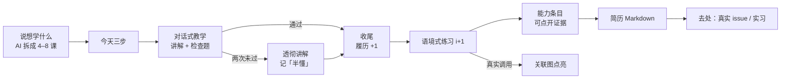
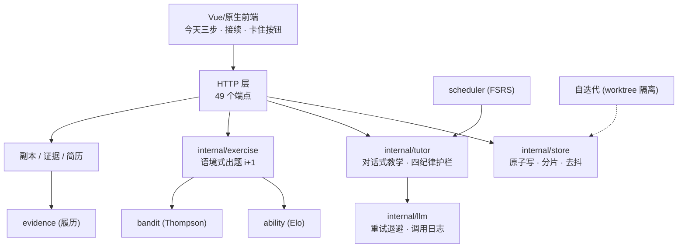

<div align="center">

# 🧭 Voyage · 前哨 2.0

**一个 Windows 桌面学习机：不知道从哪下手，就跟着它把第一个能跑的东西做出来。**

给没人带的孩子一艘船 —— 不是又一个 AI 聊天框。


</div>

---

## 30 秒看懂

1. 打开首页 → 只有**今天三步**（讲一节课 → 做一道题 → 过一个副本）
2. 点当前步 → 助教第一句就是**「现在就做这一件」**，具体到文件与命令
3. 做完打勾 → 副本通关产出一张纪念卡 → 自动变成**一条可点开验证的简历条目**

没有课程表要你安排，没有排行榜要你追。

---

## 快速开始（Windows）

```powershell
# 1. 需要 Go 1.26+
go version

# 2. 构建
go build -o voyage.exe ./cmd/voyage

# 3. 配置模型（DeepSeek 或任意 OpenAI 兼容端点）
#    编辑 outpost2-data/llm.json：
#    { "baseUrl": "https://api.deepseek.com", "model": "deepseek-chat", "key": "sk-..." }

# 4. 启动
.\voyage.exe serve --no-open
# 打开 http://127.0.0.1:7412
```

也可以直接双击 `启动前哨.cmd`。

> 数据全部落在本地 `outpost2-data/`：不联网同步、不上传、不收集。

> **项目名 = voyage**：module 名、构建入口（`./cmd/voyage`）、可执行 `voyage.exe` 都是它——历史上曾叫 outpost。数据目录 `outpost2-data/` 的名字**特意保留不改**：那是你的真实数据所在位置，改名就要动数据，不值得。

---

## 它和「直接问 AI」有什么不一样

| 直接问 AI | Voyage |
|---|---|
| 每次都要重新自我介绍 | **接续**：首页第一句是「上次你停在 X，今天先补这个」，一个按钮从断点继续 |
| 卡住了只能继续问，越问越迷糊 | **卡点提示**：「我卡住了」第一次只给一句最小提示，两次才给完整解法 |
| 学完什么都拿不出来 | **可验证作品**：副本通关 → 能力条目 → 简历 Markdown，每条挂你自己的仓库/文件证据 |

再加三条不常见的：
- **今天有多少时间**决定今天的量（10 分钟就只做一步），不是课程表决定；
- **暂停是计划的一部分**：按「我先停两周」，不推送、不断签、不算落后；
- **关联图只画真的**：蓝线是练习里真实调用过的知识点（×N 次），不是手工标注。

---

## 学习闭环



---

## 截图

| 方向 · 接续 | 判定与出口 | 练习 |
|---|---|---|
|  |  |  |

| 沉淀（已学会） | 知识地图 | 阅读/孵化池 |
|---|---|---|
|  |  |  |

---

## 架构



关键设计：
- **收尾是唯一里程碑**：答对检查题 → 履历 +1 → 练习解锁 → 图点亮，全部状态由它派生；
- **写操作三重闸门**：环境变量 + `confirm=true` + UI 二次确认，默认只读；
- **数据安全**：`state.json` 原子写（tmp+rename）、互斥锁、300ms 去抖、损坏自动回退 `.bak`；
- **性能护栏**：序列化缓存 + ETag/304 + 会话分片，实测 `/api/state` ≈ 1.2ms（阈值 10ms 有基准测试卡住）；
- **自迭代隔离**：一律在 `git worktree` 跑，产物是 patch，人工确认后合并；涉及 `outpost2-data/` 或 schema 变更的不自动提交。

<details>
<summary><b>模块表</b></summary>

| 层 | 职责 | 模块 |
|---|---|---|
| 调度 | 今天做什么：产出物 × FSRS × 精力 | `internal/scheduler` `internal/bandit` |
| 教学 | 拆课 / 四纪律护栏 / 判定 / 收尾 | `internal/tutor` |
| 练习 | 语境式出题 + 批改 | `internal/exercise` |
| 履历 | 知道 / 用过 / 做过 + 证据导出 | `internal/evidence` |
| 能力 | Elo 难度带 50–90% 校准 | `internal/ability` |
| 策略 | Thompson 选题 + 楼梯式难度 | `internal/bandit` |
| 自迭代 | 低峰自主实现观察 | `RunIterate` |

</details>

---

## 现在有什么 / 还没有什么

**已经能用**：对话式教学、练习、副本、简历与证据、去处页（真实 good first issue）、暂停、导出全部数据、深色模式、快捷键、接续。

**还没有**（诚实清单）：
- 多用户 / 多档案 —— 目前一份 `state.json`
- 云端同步 —— 有意不做
- macOS / Linux —— 只做 Windows，其它端等这端做到 100 分
- 内容库 —— 助教就是内容源，不做课程市场

## 测试

```powershell
go test ./...          # 101 个测试
go test -cover ./...   # 覆盖率：核心包 87–97%，llm/tutor 待补
```

CI 只做两件事：`go build ./...` 与 `go test ./...`。

---

## 路线图

- [x] 今天三步 + 接续 + 卡点提示
- [x] 副本 → 证据 → 简历链路
- [x] 数据安全（原子写/锁/自愈）
- [x] 性能护栏（ETag/分片/基准）
- [ ] llm / tutor 测试补齐至 80%
- [ ] 拆 Server 上帝对象（store / service / http 三层）
- [ ] 按已学知识点过滤去处页

## 许可

代码 MIT；知识库内容 CC-BY-SA 4.0。
