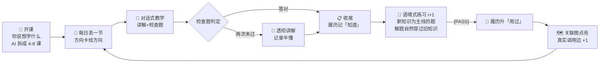
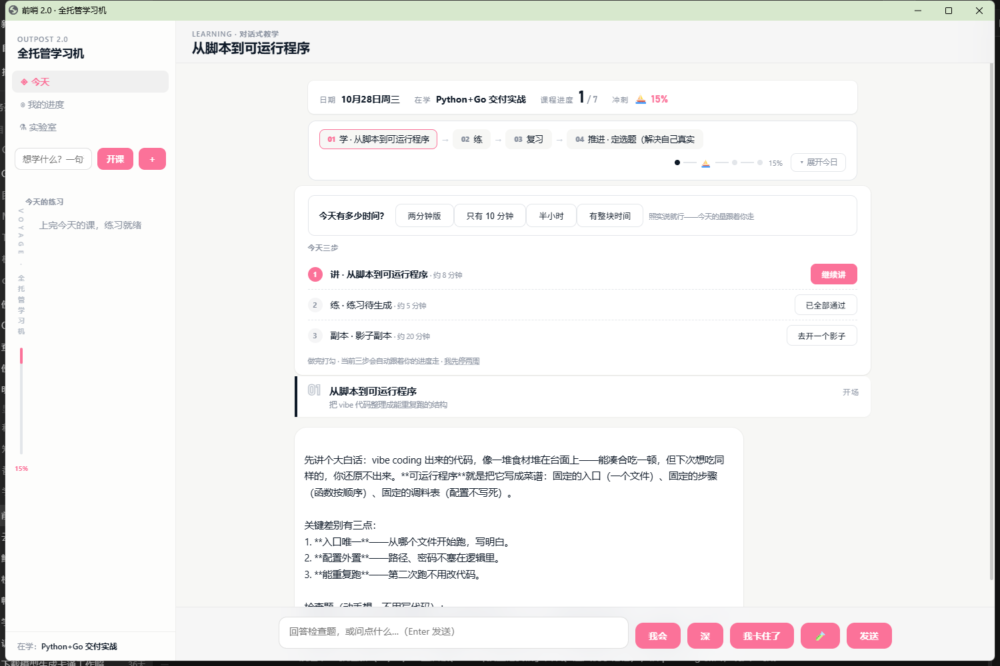
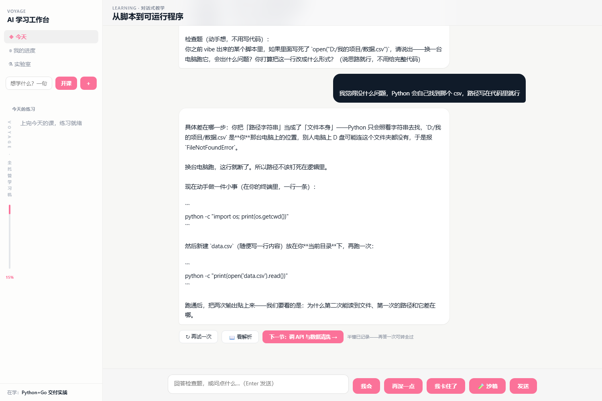
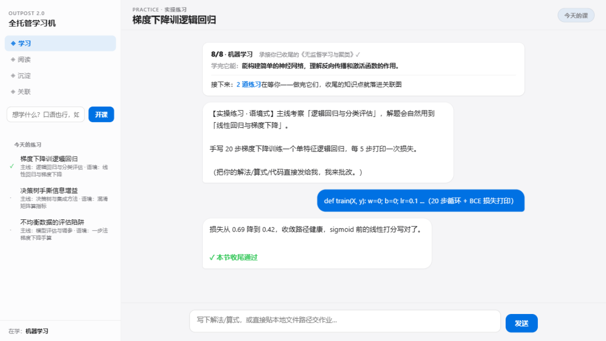
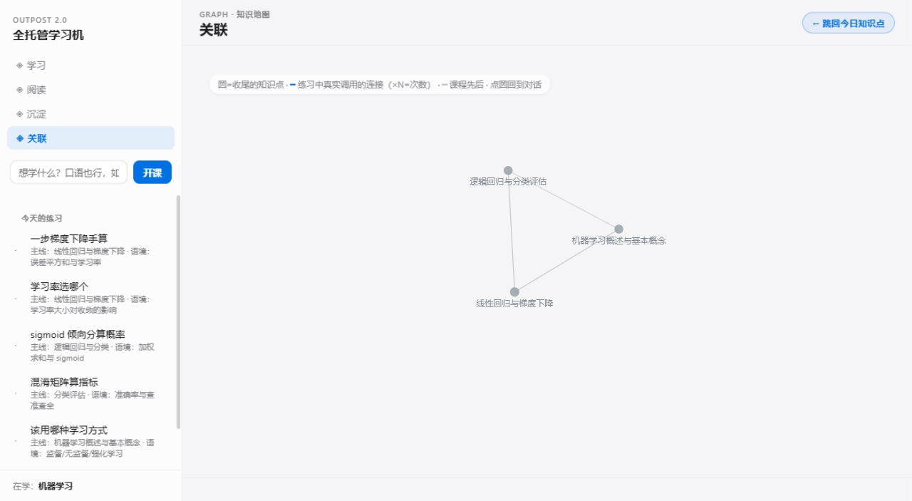
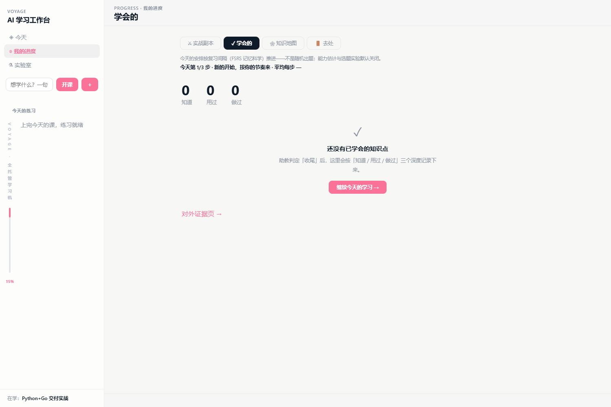
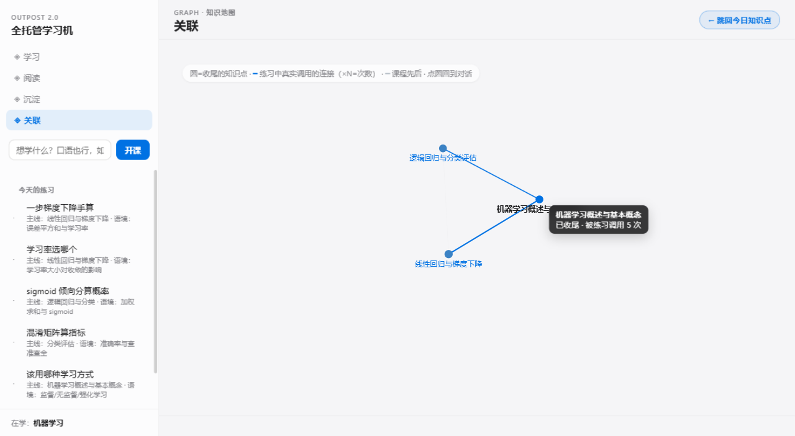
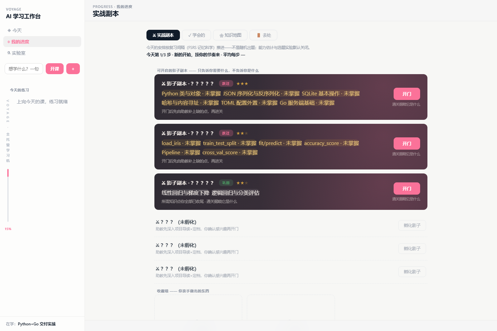

<div align="center">

# 🧭 Voyage — 前哨 2.0

**自学是一场有方向的远航**

一台「学会了，且想继续学」的全托管学习机。
课程为你拆好 · 练习随你收尾生长 · 地图随你收尾点亮


<video src="docs/voyage-demo.mp4" controls width="860"></video>

*45 秒真实使用录制：答检查题 → 混淆矩阵追问 → 收尾推进 → 练习 / 沉淀 / 关联 / 阅读*

</div>

---

## ✨ 它解决什么

| 通用 AI 学习产品的病 | Voyage 的解法 |
|---|---|
| Streak / 打卡 / 进度条制造焦虑，学不动就卸载 | **收尾 = 唯一里程碑**。没有任务墙，进度由收尾速度决定；方向卡写着「休息也是正当的」 |
| LLM 直接出题：超纲、编造、难度漂移 | **RL 管决策，LLM 管生成**。bandit 选题 + Elo 难度带 + 只考课上讲过的内容，三重围栏 |
| 学完就忘，没有复习；一切靠 AI，失去独立思考 | **语境式练习（i+1）** 巩固旧知识 + **阅读管理器**保持一手理解力 |

## 🎯 核心理念（宪法速览）

> **目标函数：学会了，且想继续学。** 不是 DAU，不是留存率，不是完课率。

- **收尾 = 唯一里程碑**：对话里答对检查题即收尾 → 履历 +1 → 练习解锁 → 关联图点亮。全部系统状态由它派生。
- **方向卡永远回答三个问题**：我在哪（n/N）· 为什么是它（承接关系 + 学完能做什么）· 接下来做什么（唯一建议）。
- **数据是资产不是指标**：履历单一真相源 + 跨重启回归测试；一切策略参数可审计。

[完整产品宪法 →](docs/CONSTITUTION.md)

## 🔄 学习闭环



练习难度与选题由自适应策略驱动：
**Thompson Sampling 选题**（利用/探索自动平衡）× **Elo 难度带 + 楼梯式调整**（连对上探、受挫回落）× **在线后验更新**（每次批改即训练，参数全可审计）。

## 🖼 一眼看完

| 方向卡 | 对话式教学 |
|---|---|
|  |  |
| ***我在哪 · 为什么是它 · 接下来做什么***，每次打开先回答 | 检查题 → 加深追问 → 收尾，履历自动记录 |
| **语境式练习（i+1）** | **极简知识地图** |
|  |  |
| 新知识为主线，解题自然穿过旧知识——像 90% 词汇认识的英语文章 | 小灰点安静图：hover 聚焦邻域，蓝色连线 = 练习中真实调用 |

<details>
<summary><b>更多截图：沉淀履历 · hover 聚焦 · 阅读管理器</b></summary>

| 沉淀（履历三深度） | 关联图 hover 聚焦 | 阅读管理器 |
|---|---|---|
|  |  |  |

</details>

## 🏗 架构

<details>
<summary><b>五层架构与模块表</b></summary>

| 层 | 职责 | 模块 |
|---|---|---|
| 调度层 | 今天丢什么：产出物 × FSRS × 精力 → 今日计划 + bandit 形态学习 | `internal/scheduler` `internal/bandit` |
| 教学层 | 对话式教学：拆课 / 护栏四纪律 / [PASS] 判定 / 收尾盲区自查 | `internal/tutor` |
| 练习层 | 语境式出题（i+1）+ 批改 + 本地文件提交 | `internal/exercise` |
| 履历层 | 知道 / 用过 / 做过 × 时间 × 来源 + 证据页导出 | `internal/evidence` |
| 能力评估 | Elo per 域：难度带 50-90% 校准 | `internal/ability` |
| 策略层 | Thompson bandit + 楼梯式 DDA + 真实调用边累积 | `internal/bandit` + server |
| 知识库层 | 原文锚定 / 指纹闸门 / 批判批注 + CC-BY-SA 导出 | `internal/kb` |
| 毕业层 | Learning→Maintaining→Graduated，毕业=调度权交还 | `internal/graduation` |
| 阅读层 | 原文材料管理（中文整理/翻译/阅读状态） | server + `content/readings` |

</details>

<details>
<summary><b>策略：RL 管决策，LLM 管生成</b></summary>

- **选题**：Thompson Sampling——高奖励知识点多出（利用），低后验自动被采到（探索），零调参；
- **难度**：Elo 难度带（预期正确率 50-85%）+ 楼梯式调整（连对 3 次 bias+40 上探，受挫 -40 回落）；
- **训练**：每次批改 = 一次奖励，在线更新 Beta 后验——交互即训练，无离线梯度下降；
- **LLM 的位置**：在策略给出的结构化约束内生成题面与判定——它不决定「出什么、多难」，那需要你的历史状态。

单用户数据规模下，这是唯一诚实的强化学习形态：**后验即模型，交互即训练**。

</details>

## 🚀 快速开始

```bash
git clone https://github.com/GenshinKings/voyage.git
cd voyage
go build -o outpost2.exe ./cmd/outpost2
./outpost2.exe serve        # 自动打开 http://127.0.0.1:7412
```

配置 LLM（DeepSeek / 任意 OpenAI 兼容接口）→ `outpost2-data/llm.json`：

```json
{ "baseUrl": "https://api.deepseek.com", "key": "sk-...", "model": "deepseek-chat" }
```

> 首启自动写入种子目标。日常只有两个动作：**完成今天丢来的**、**看自己的履历**。

## 🗺 路线图

- [x] 对话式教学 + 收尾判定 + 盲区自查
- [x] 语境式练习（i+1）+ 难度自适应 + bandit 选题
- [x] 阅读管理器 + 知识地图（真实调用边）
- [x] 学习者画像记忆（方向讨论自动沉淀，教学/出题全程注入，人机共创的第一课：AI 要记得你是谁）
- [x] 错题回归（答错自动进错题本，下次换场景变式重出——自适应看得见）
- [ ] 知识库三层落地：原文抓取 → 锚定入库 → 助教基于原文教学（**最优先**）
- [ ] FSRS 复习闭环接入 2.0（对抗遗忘）
- [ ] 跨科目知识网络（连线连出单一科目）
- [ ] 多用户数据池化后的 SAKT 知识追踪评估

## 📄 授权

- 代码：**MIT**
- 知识库内容（未来）：**CC-BY-SA**（share-alike——社区共构的法律强制力）
- 来源白名单：开源仓库文档 / arXiv / CC 内容 / 公有领域书籍 / 官方文档；商业教科书只读不存

## 🤝 人机共创

Voyage 是一个人与 AI 共创的产品——不是人写代码 AI 打杂，也不是 AI 生成人盖章：

| | 角色 |
|---|---|
| **GenshinKing** | 产品负责人 & 唯一真实用户：提需求、判好坏、亲手用——每一次否定都直接改写产品规则 |
| **ZCode**（GLM） | 工程共创者：调研对标、写码测试、把「学会了，且想继续学」翻译成可运行的系统 |

共创的痕迹不止在代码：仓库根的 `AGENTS.md`（AI 助教行为约束）与 `LESSONS.md`（AI 自己的错题本）也是这套协作机制的产物。

---

<div align="center">

**学会了，且想继续学。**

[产品宪法](docs/CONSTITUTION.md) · [功能展示](docs/FEATURES.md) · [演示视频](docs/voyage-demo.mp4)

</div>
